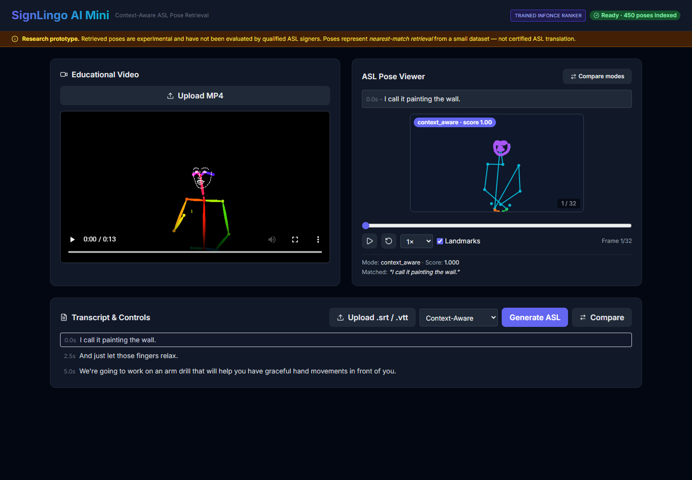

# SignLingo AI Mini — User Manual

Version 1.0 · 2026-11-21

SignLingo AI Mini retrieves the closest matching ASL pose clip for each sentence of an
uploaded transcript and plays it beside your video. This manual covers installation,
day-to-day use, administration, and production deployment.

> **Read this first.** This is a research prototype. It retrieves poses from a fixed
> dataset; it does not generate new ASL. The retrieved poses have **not** been evaluated
> by qualified ASL signers. Do not use it as an accessibility service, interpreter, or
> source of truth for ASL communication.

---

## 1. What the app does

1. You provide a short video (MP4) and its English transcript (`.srt` or `.vtt`).
2. For each transcript sentence, the backend retrieves the best-matching ASL pose clip.
3. The skeleton animation plays in sync with the video, frame for frame.
4. You can compare two retrieval modes:
   - **Text-only** — matches the sentence alone.
   - **Context-aware** — also uses the previous sentence and the previous pose.

The video file never leaves your browser. Only transcript text is sent to the backend.

---

## 2. Requirements

### End-user browser

- Microsoft Edge or Google Chrome (recent version).
- **H.264/AAC MP4** is recommended. WebM (VP9/Opus) also plays in Edge/Chrome.
  Other codecs may play audio with a black frame.

### Server / workstation

- Python 3.10 or newer (tested on 3.12).
- Node.js 18 or newer (tested on 22) — only needed to build the frontend.
- 2 GB RAM recommended (sentence-transformer model + retrieval index).
- Ports: `8000` (API) and `5173` (development UI). In production, one HTTPS port.

---

## 3. Quick start (local demo)

Open PowerShell in the project folder:

```powershell
cd "C:\Users\manoj\OneDrive\Dokumen\Desktop\Research\SignLingo-AI-Mini"
pip install -r requirements.txt
cd frontend
npm install
cd ..
```

Start the backend (terminal 1):

```powershell
cd "C:\Users\manoj\OneDrive\Dokumen\Desktop\Research\SignLingo-AI-Mini"
uvicorn backend.main:app --reload --port 8000
```

Start the frontend (terminal 2):

```powershell
cd "C:\Users\manoj\OneDrive\Dokumen\Desktop\Research\SignLingo-AI-Mini\frontend"
npm run dev
```

Open <http://localhost:5173>. The header should show **Ready** and the number of indexed
clips (for the included real index: **450 poses indexed**).

A normal educational demo with spoken captions is included:

- `demo/educational_cravat.webm` — 1:18 instructional video ("How to tie a Cravat")
- `demo/educational_cravat.srt` — 22 English cues, timing unchanged

Upload both files to see captions from a regular teaching video mapped to ASL poses
retrieved from the How2Sign subset. The app does not generate signs from the speaker;
it retrieves the closest dataset pose for each caption. The clip is CC BY 3.0
(Coes Fashion, via Wikimedia Commons); see `demo/educational_cravat_SOURCE.txt`.

---

## 4. Using the app



### Step 1 — Check status

The top-right badge must say **Ready**. If it says the index is missing, see
[Administration](#8-administration). A red **SYNTHETIC DATA** banner means the app is
running on generated test poses, not real ASL; do not demo in that state.

### Step 2 — Upload the video

In the left **Educational Video** panel, click **Upload MP4** and choose your file.
The video preview appears immediately. Use the native video controls or the pose panel
controls (play, restart, speed) to review it.

### Step 3 — Upload the transcript

In the bottom **Transcript & Controls** panel, click **Upload .srt / .vtt**.
Accepted formats:

- `.srt` (SubRip) and `.vtt` (WebVTT)
- UTF-8 text, up to 500 KB
- Standard timestamps (`00:00:01,500 --> 00:00:03,000`)

Example `.srt`:

```srt
1
00:00:00,000 --> 00:00:02,500
I call it painting the wall.

2
00:00:02,500 --> 00:00:05,000
And just let those fingers relax.
```

Each cue becomes one retrieval query. Cues with whitespace-only text are skipped.
The transcript list appears after upload.

### Step 4 — Choose a mode

Use the dropdown next to the transcript buttons:

- **Context-Aware** — recommended; uses previous sentence and pose.
- **Text-Only** — sentence text only.

### Step 5 — Generate ASL

Click **Generate ASL**. The app parses the transcript, retrieves one pose clip per
sentence, and loads the first result. Generation is local; no external AI service is called.

### Step 6 — Play and inspect

- The skeleton animation tracks the video timeline. Play, pause, seek, change speed,
  or let it loop; the frame follows the video within one frame.
- **Playback controls** in the pose panel: play/pause, restart, speed (0.5x–2x),
  and a scrub slider.
- **Landmarks** toggles keypoint dots on the skeleton.
- The frame counter shows `Frame N / total`.
- Below the canvas: the retrieval mode, similarity score, and the matched dataset sentence.

### Step 7 — Jump between sentences

Click any sentence in the transcript list. The video seeks to that sentence's start time
and the animation switches to its pose. The active sentence is highlighted.

### Step 8 — Compare modes

Click **Compare** (or **Compare modes**) to run both retrievers for the current sentence.
The panel shows text-only and context-aware results side by side and reports whether they
returned the same clip.

### Reading the score

`score` is a similarity value in roughly 0–1 (higher is closer). It is **not** an accuracy
or correctness measure. A low score means the dataset has no close match; the app then
shows a caption-only fallback instead of inventing ASL.

---

## 5. Supported content

- Short educational videos, typically 15–60 seconds. Longer videos work but produce more
  sentences and slower batch retrieval.
- English transcripts that match the spoken content and timing.
- Dataset coverage: How2Sign validation clips (educational/instructive domain). Sentences
  far outside that domain will retrieve a weak match.

---

## 6. Privacy and data handling

- The **video stays in the browser**; it is loaded from a local object URL and is never
  uploaded to the backend.
- Only the **transcript text and timestamps** are sent to the backend for retrieval.
- The backend processes requests in memory. There is no user database, no analytics, and
  no persistent upload storage.
- The retrieval index contains public How2Sign captions and pose arrays.
- No authentication is built in. See the deployment checklist before exposing the service.

---

## 7. Troubleshooting

| Symptom | Cause / fix |
|---|---|
| Badge says “Index not ready” | No `models/retrieval_index.pkl`. Build it (Section 8) and restart the backend. |
| Red **SYNTHETIC DATA** banner | Running on synthetic poses. Rebuild with real data and restart. |
| Video is black but audio plays | Unsupported codec. Use H.264/AAC MP4 or WebM VP9; use Edge/Chrome. |
| “Failed to parse transcript” | File is not `.srt`/`.vtt`, is malformed, or exceeds 500 KB. Validate timestamps. |
| Fetch/network errors in the browser | Backend not running, wrong port, or production proxy missing `/api`. |
| First page load is slow | The sentence-transformer model loads at backend startup (10–30 s). |
| `Address already in use` | Another process uses port 8000/5173. Stop it or choose another port. |
| No pose / “no match” | Dataset has no close caption. This is expected outside the dataset domain. |

Health checks:

```powershell
Invoke-RestMethod http://localhost:8000/api/health
Invoke-RestMethod http://localhost:8000/api/status
```

---

## 8. Administration

### Rebuild the retrieval index

```powershell
cd "C:\Users\manoj\OneDrive\Dokumen\Desktop\Research\SignLingo-AI-Mini"
python ml/build_real_index.py --data-dir data/real --epochs 40
```

This converts any new OpenPose clips, trains the ranker, and writes:
`models/retrieval_index.pkl`, `models/ranker.pt`, `models/ranker_train_log.csv`.
Restart the backend after rebuilding; the index is loaded at startup.

### Refresh from the raw How2Sign archive

```powershell
python ml/build_real_index.py `
  --openpose-json C:/how2sign/extracted/openpose_output/json `
  --csv C:/how2sign/how2sign_realigned_val.csv `
  --out-dir data/real --limit 450 --epochs 40
```

### Configuration

| Variable | Default | Purpose |
|---|---|---|
| `DATA_DIR` | `data` | Folder containing `metadata.csv` and `poses/` |
| `POSE_DIR` | derived from `DATA_DIR` | Explicit pose folder |
| `INDEX_PATH` | `models/retrieval_index.pkl` | Retrieval index |
| `RANKER_PATH` | `models/ranker.pt` | Trained ranker checkpoint |

Set them in the environment before starting uvicorn, for example:

```powershell
$env:INDEX_PATH = "models/retrieval_index.pkl"
$env:RANKER_PATH = "models/ranker.pt"
```

### Verification after changes

```powershell
python -m pytest tests -q
cd frontend
npm run build
npm run test:e2e
```

Expected: 31 pytest tests pass, the build has no TypeScript errors, and 3 Playwright tests
pass (they require Microsoft Edge).

---

## 9. Production deployment

### 9.1 Build the frontend

```powershell
cd frontend
npm install
npm run build
```

The static site is written to `frontend/dist`. The frontend calls the API at the relative
path `/api`, so serve the site and the API on the **same origin**.

### 9.2 Run the API

```powershell
cd "C:\Users\manoj\OneDrive\Dokumen\Desktop\Research\SignLingo-AI-Mini"
uvicorn backend.main:app --host 127.0.0.1 --port 8000 --workers 1
```

Use **one worker** unless you have memory for one model + index per worker. Do not use
`--reload` in production. Run it under a process manager (systemd, NSSM, Task Scheduler)
with automatic restart.

### 9.3 Put both behind one HTTPS reverse proxy

Example nginx site:

```nginx
server {
    listen 443 ssl;
    server_name signlingo.example.org;

    root /srv/signlingo/frontend/dist;
    index index.html;

    location / {
        try_files $uri /index.html;
    }

    location /api/ {
        proxy_pass http://127.0.0.1:8000;
        proxy_set_header Host $host;
        proxy_read_timeout 120s;
    }
}
```

Same-origin serving avoids CORS. The backend currently allows only localhost origins; if
you must serve the UI from a different origin, update `allow_origins` in
`backend/main.py` to your exact HTTPS origin.

### 9.4 Deployment checklist

Before exposing the service:

- [ ] Real index present; header shows **Ready** and the expected clip count.
- [ ] No **SYNTHETIC DATA** banner.
- [ ] HTTPS enabled; HTTP redirects to HTTPS.
- [ ] Authentication / SSO added in front of the app — **the app has no login**.
- [ ] Network access restricted to intended users.
- [ ] Process manager restarts the API on failure; logs are collected.
- [ ] Backups or rebuild instructions for `models/` and `data/real/` are documented.
- [ ] Users have read the limitations and know results are not certified ASL.

### 9.5 Operational limits

- Single-instance, single-user-oriented prototype; no job queue or rate limiting.
- Index size grows with the dataset; the included 450-clip index is about 76 MB.
- Large transcript batches retrieve sequentially and can take several seconds.
- No hot reload of the index or checkpoint; restart the API after rebuilding.

---

## 10. Limitations and responsible use

- Retrieval only. The app never synthesizes new signing.
- Poses are automatic OpenPose estimates on How2Sign clips, not manually verified ASL.
- Retrieval metrics (Recall/MRR) do not measure ASL correctness.
- No evaluation by Deaf ASL signers has been completed. The kit is in `eval/` and marked
  **PENDING HUMAN EVALUATION**.
- How2Sign data is **CC BY-NC 4.0**: research and non-commercial use only. Preserve
  attribution (`data/real/DATASET_SOURCE.txt`).
- The educational demo clip is **CC BY 3.0** (Coes Fashion); preserve attribution in
  `demo/educational_cravat_SOURCE.txt`.
- Do not present output as an interpreter, translation, or accessibility compliance tool.

---

## 11. Support information to collect

When reporting a problem, include:

1. Browser and version, operating system.
2. Backend console output around the failure.
3. `/api/status` response.
4. The transcript file (if it is not confidential) and the exact steps reproduced.
5. Whether the **SYNTHETIC DATA** banner was visible.

Project documentation: `README.md` (setup and evaluation), `WORKLOG.md` (engineering log),
`eval/PROTOCOL.md` (human evaluation protocol).
